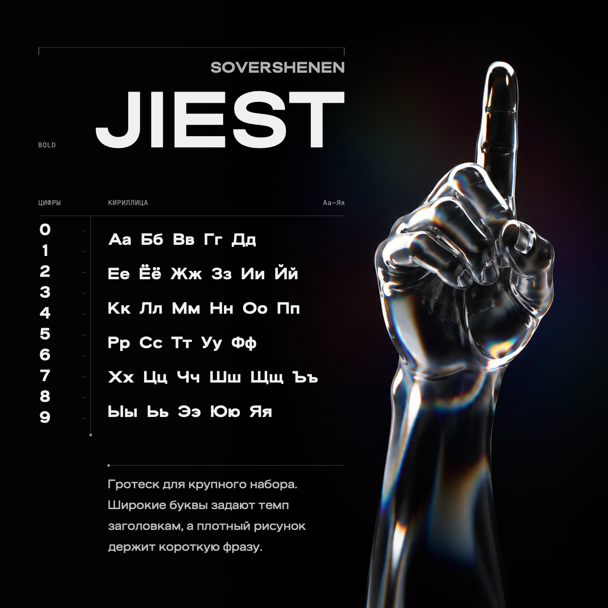

# Sovershenen Jiest

Sovershenen Jiest — современный шрифт без засечек с широкими пропорциями и сдержанным характером. Подходит для заголовков, айдентики и интерфейсов.

По характеру Sovershenen Jiest можно представить как более спокойную и узкую альтернативу Benzin: выразительный санс с широкими формами, но без такой нарочитой брутальности.

В семействе шесть насыщенностей — Thin, Light, Regular, Medium, Semibold и Bold. У каждой есть курсивное начертание. Поддерживаются кириллица и латиница.

- **OTF** — для установки на компьютер.
- **WOFF2** — для использования на сайтах.

Шрифт распространяется под [SIL Open Font License 1.1](OFL.txt).
